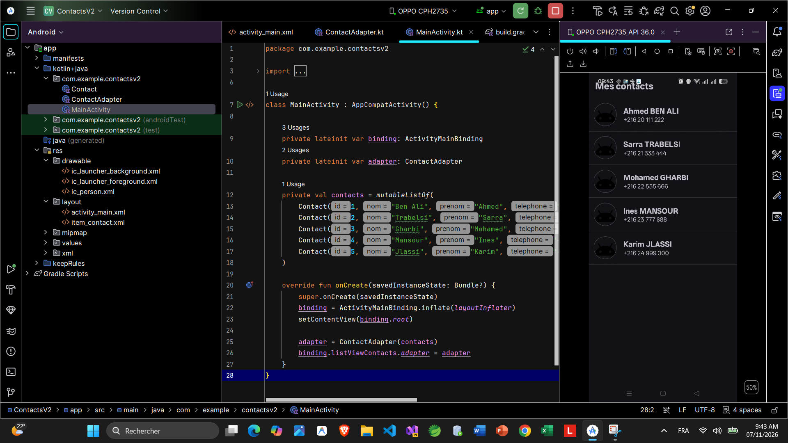
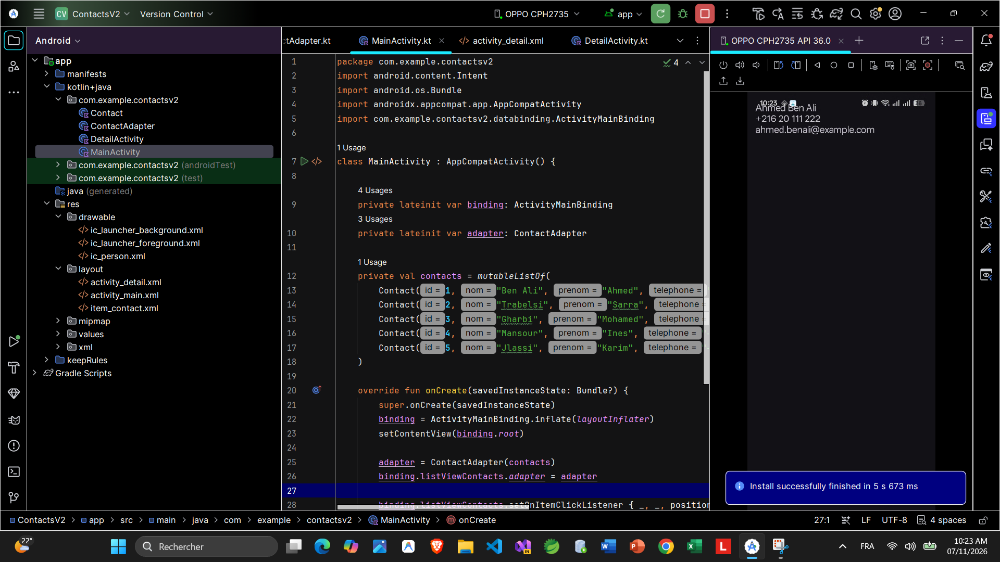
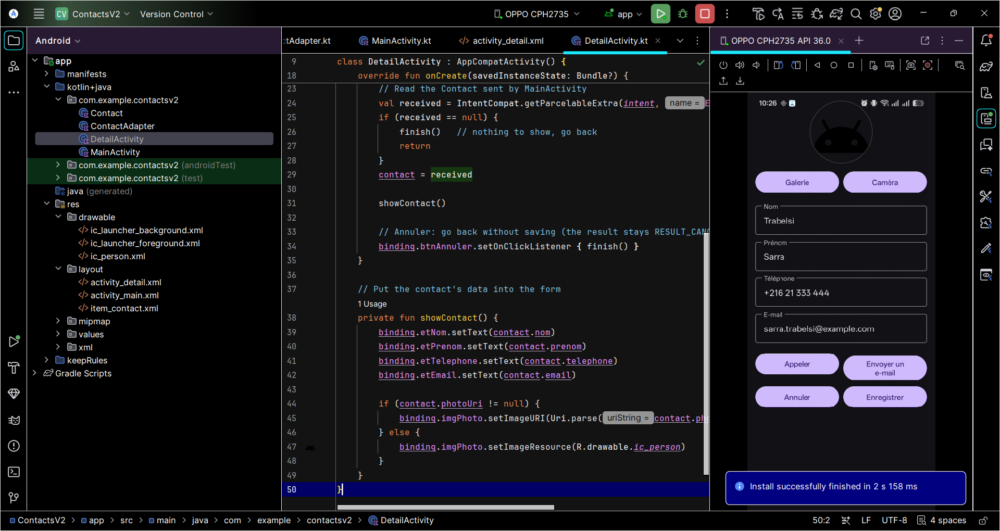
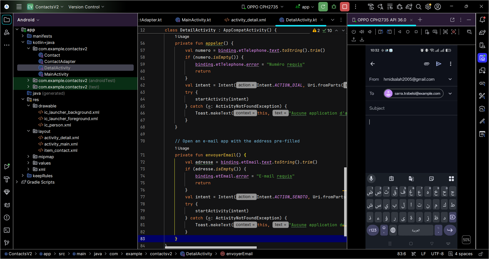
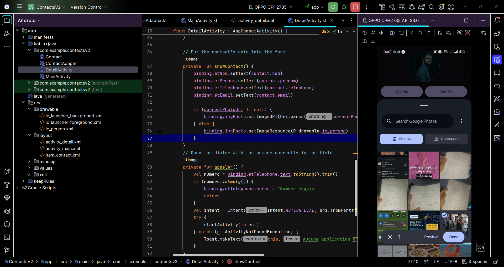
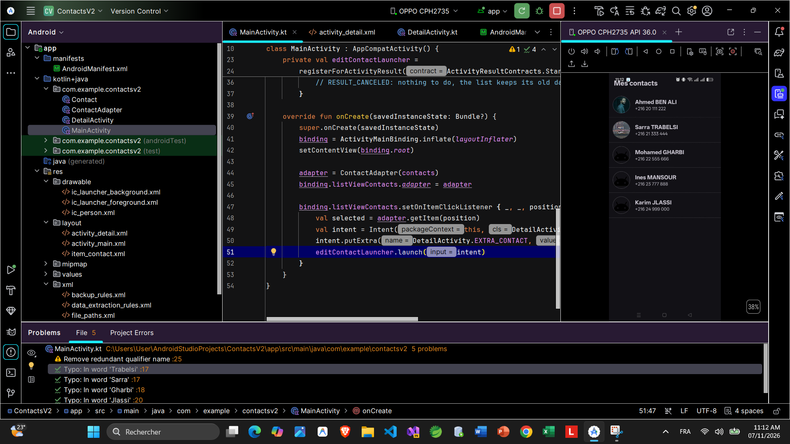
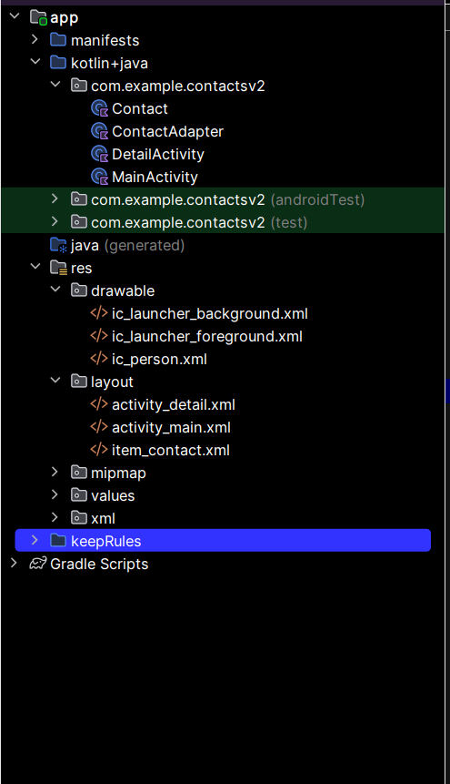

# TP Android — Liste de contacts (Version 2)

Application Android en **Kotlin** (interfaces XML) qui gère une liste de contacts avec deux activités : `MainActivity` et `DetailActivity`.

- **Auteur :** Ahmed Salah
- **Formation :** Licence en Technologies de l'Information, parcours DSI — ISET Djerba
- **Outils :** Android Studio, Kotlin, ViewBinding, Material Components
- **Test réalisé sur :** téléphone réel (OPPO CPH2735, Android 16 / API 36)

---

## Fonctionnalités

- Liste de contacts dans une `ListView` personnalisée (photo, prénom, nom, téléphone)
- Ouverture de `DetailActivity` par un **Intent explicite** avec transmission du contact (`Parcelable`)
- Affichage et modification du nom, prénom, téléphone et e-mail
- Bouton **Appeler** : Intent implicite `ACTION_DIAL` (ouvre le composeur, sans permission)
- Bouton **Envoyer un e-mail** : Intent implicite `ACTION_SENDTO` avec l'adresse préremplie
- Choix d'une photo dans la **galerie** (Photo Picker, sans permission)
- Prise d'une photo avec la **caméra** (permission `CAMERA` + `FileProvider`)
- Boutons **Enregistrer** / **Annuler** avec l'**Activity Result API** et actualisation immédiate de la liste
- Gestion des cas courants :
  - champs obligatoires vides (nom, prénom, téléphone) et e-mail invalide
  - sélection de photo annulée
  - absence d'application compatible (`ActivityNotFoundException`)
  - permission caméra refusée ou caméra indisponible
  - rotation de l'écran (état sauvegardé avec `onSaveInstanceState`)

---

## Structure du projet

| Fichier | Rôle |
|---|---|
| `Contact.kt` | Modèle de données (id, nom, prénom, téléphone, e-mail, photo), implémente `Parcelable` |
| `ContactAdapter.kt` | Adapter personnalisé (`BaseAdapter`) pour les lignes de la `ListView` |
| `MainActivity.kt` | Affiche la liste, ouvre le détail, reçoit le contact modifié |
| `DetailActivity.kt` | Formulaire de modification, appel, e-mail, galerie, caméra, enregistrement |
| `res/layout/activity_main.xml` | Écran de la liste |
| `res/layout/item_contact.xml` | Ligne personnalisée d'un contact |
| `res/layout/activity_detail.xml` | Formulaire de détail |
| `res/xml/file_paths.xml` | Chemins du `FileProvider` pour les photos de la caméra |

---

## Captures d'écran

### Liste des contacts (`MainActivity`)

### Passage des données par Intent explicite
Premier test : le contact sélectionné est bien transmis à `DetailActivity`.

### Fiche du contact (`DetailActivity`)

### Envoyer un e-mail (Intent implicite)
L'application de messagerie s'ouvre avec l'adresse du contact préremplie.

### Choix d'une photo dans la galerie

### Résultat : liste actualisée avec les photos
Après **Enregistrer**, la liste affiche immédiatement les nouvelles données et photos.

### Organisation du projet dans Android Studio

---

## Tests effectués

| Test | Résultat |
|---|---|
| Ouvrir un contact, modifier ses informations, enregistrer | La liste est mise à jour immédiatement |
| Modifier puis **Annuler** | Les anciennes données restent inchangées |
| Bouton **Appeler** | Le composeur s'ouvre avec le numéro saisi |
| Bouton **Envoyer un e-mail** | Gmail s'ouvre avec l'adresse préremplie |
| Choisir une photo dans la galerie | La photo s'affiche et apparaît dans la liste après enregistrement |
| Prendre une photo avec la caméra | La photo s'affiche et apparaît dans la liste après enregistrement |
| Champs obligatoires vides | Message d'erreur sur le champ, l'écran reste ouvert |
| E-mail invalide | Message « E-mail invalide » |
| Annuler le choix de photo | Message « Aucune photo sélectionnée », l'ancienne photo est conservée |
| Permission caméra refusée | Message « Permission caméra refusée » |
| Rotation de l'écran | Photo et liste conservées |

---

## Difficultés rencontrées

- **Plugin Parcelize non reconnu** avec le modèle de projet récent : `Parcelable` a été implémenté manuellement dans `Contact.kt`.
- **URI de la galerie temporaires** : l'image choisie est copiée dans le stockage interne de l'application pour rester affichable.
- **Caméra** : nécessite la permission `CAMERA` et un `FileProvider` pour que l'application caméra puisse écrire la photo.
- **Rotation de l'écran** : la photo choisie et la liste modifiée étaient perdues, d'où l'usage de `onSaveInstanceState`.

---

## Lancer le projet

1. Cloner le dépôt : `git clone https://github.com/ah-med-sal-ah/ContactsV2.git`
2. Ouvrir le dossier dans **Android Studio**.
3. Attendre la synchronisation Gradle.
4. Lancer l'application (▶) sur un émulateur ou un téléphone Android (API 24 minimum).

> Les contacts sont stockés en mémoire uniquement : en fermant complètement l'application, la liste revient aux données d'exemple.
